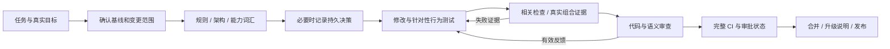

# Agent-Native：让 Agent 能参与工程，而不是只生成代码

[返回概览](README.md) · [六个案例](cases.md)

## 能确认的定义与证据

这里把 Agent-Native 当作工程设计目标：Agent 能发现项目约束，使用真实开发工具，得到可定位反馈，维护任务连续性，并交付可被独立检查的结果。它不等于每次都由多个 Agent 并行，也不等于“无人开发”。

公开证据分三层：根/子树指令和 skills 是期望流程；CI、目录生成器与测试是可执行机制；GUI 复盘中记录的实际 Agent 行为是具体实践。官方早期 doc-sync 笔记称项目主要由 agents 构建，但这属于维护者描述，不是本次可量化的贡献统计。[S09](sources.md#s09)、[S43](sources.md#s43)

## 从任务到交付的流程

这条图是从指令、工作流和案例交叉归纳的流程 I，不是假称所有任务都有完整公开执行轨迹。

## Agent 怎样理解项目

根 `AGENTS.md` 保持短规则与权威链接，子树补具体约束；架构页给地图，子系统页讲类型与语义，package README 讲局部能力，Agent Notes 讲为什么取舍，skills 给可复用过程。它们各有职责，避免每个新 Agent 先读长篇历史流水账。[S02](sources.md#s02)、[S14](sources.md#s14)

能力目录和接口文档从源码生成，让 Agent 看到准确的服务、事件、配置和工具。模型看到什么是重要的审查角度：不只检查类型，还要看具体 prompt、工具 schema、结果和诊断是否帮助它完成任务。[S12](sources.md#s12)、[S31](sources.md#s31)、[S32](sources.md#s32)

## 怎样定义范围与组织工作

相关检查 skill 要求确认真实 PR base 或 stack parent，`change-scope` 输出已提交、staged、unstaged 和 untracked 范围；它不猜基线。范围变化后重新判断哪些证据失效，已通过且未失效的检查不用因“马上提交”再跑一次。[S11](sources.md#s11)

复杂决策写 Note，局部机械/UI 修改豁免。Note 记录问题、决定、真实替代方案和代价；提案实施后改写为当前事实；失去当前指导价值的历史可封印归档。这样交接保留的是决策依据，不是大量内部推理过程。[S03](sources.md#s03)

有依赖的 PR 用单独 worktree 与 stack 工作流，审查以实际 base/head 为准；合并、变基后校验证据。仓库规范支持这些组织方法，但本次无法从公开 PR API 恢复所有评审对话，也没有证据证明每个任务都自动采用子 Agent。[S50](sources.md#s50)

## 执行与失败反馈

测试优先保留真实下游实现，只 mock 模型、网络、时间等昂贵或不确定边界。对外可见的行为走实际 profile/Loader/bin；断言检查文件、事件、日志和浏览器状态，不能只查 Agent 最后说了“完成”。[S15](sources.md#s15)

CI runner 记录叶子检查输出、耗时、退出码、信号与 skipped 状态；需要 build 的消费者声明依赖。进程失败有证据，失败路径不继续假设前置条件成立。测试自身也必须管理端口、临时路径、环境变量、子进程与异步 teardown：发出 kill 不代表子进程已经退出。[S18](sources.md#s18)、[S13](sources.md#s13)

这改善了 Agent 的修复输入：定位到具体规则、位置与外部失败后再修改，而不是重复整套测试碰运气。它仍要求语义审查；补更多断言并不自动建立正确测试场景。

## 恢复与连续性：开发过程和产品能力要分开

| 层面 | 机制 | 可以确认与不能确认的事 |
| --- | --- | --- |
| 工程交接 | Git/worktree、base/head、决策记录、公开升级说明与当前文档 | 后续 Agent 能复查范围和理由；不能据此证明完整任务会自动恢复 |
| DSH 产品会话 | 持久事件、输入队列、Session 派生、压缩与回放 | 模型可见内容可由日志重建；受制于提交/结算和格式边界 |
| DSH 产品目标 | Goal 与同会话 round driver | 目标与续轮是独立能力；不等于每个仓库开发任务都由 Goal 自动驱动 |
| 临时运行资源 | 进程、worker、动态注册与 effect disposal | 生命周期可管理；历史工具调用不能安全地任意重放外部副作用 |

产品机制见 [S46](sources.md#s46)、[S47](sources.md#s47)、[S48](sources.md#s48)、[S49](sources.md#s49)。研发自用证据另见 GUI 事故，不能用“有 Goal 模块”代替“团队已经如此开发”的证明。

## 人类控制与防止规则被弱化

代码审查 skill 要求检查需求、边界、外部状态、真实加载路径和负向对照，还要求确认检查与 diff 匹配。自动文档检查不能评价解释准确度；双语 hash 不能证明翻译质量。[S12](sources.md#s12)

加权审批工作流从受信任默认分支运行策略，不执行 PR 代码，并针对最新 PR head 发布状态。作者自己提交 review 不计分，但历史合并贡献可提供有限 credit；具有写权限的 bot 和人类按同一评分机制处理。不能把该机制称为“必然真人审批”。平台是否把该 status 设为必需，以及 stale-review/最新推送要求，仍需设置和权限证据。[S35](sources.md#s35)、[S37](sources.md#s37)

## 有实际行为记录的自用案例

GUI 复盘公开了会话 ID、cwd 和多个事件序号：DSH Web Agent 修改自身 GUI 后，先把验收推回用户，再以裸 Vite 的 HTTP 200 当成功，随后开替代端口验证，最后才检查用户原端口。这是具体的自用/反馈失败记录，而不是依据 commit 署名的猜测。[S43](sources.md#s43)

修复增加日志化的 GUI 地址与运行模式、shell 可查询的地址和原页面验证。它说明 Agent-Native 开发必须让 Agent 知道运行目标并接触外部结果；服务发现、测试和上下文共同弥补了失误。本次未获取该研发会话原始 JSONL，因此不声称全文公开。

## 效率与局限

有证据支持的机制是相关检查选择、窄 hooks、并行 CI、构建依赖裁剪、取消旧 revision、限制并发和测试资源回收。它们减少重复或等待的方向明确；公开笔记提供特定运行耗时，详见 [CI 章节](ci.md)。

缺少完整任务人时、返工率、Agent 贡献占比与同规模对照。因此不能给出“效率提高 X 倍”结论，也不能宣称这套流程解决了长期自主开发全部问题。Agent 也会选错验收目标、做错误归因；关键是错误能被看见并转成可失败的检查。
