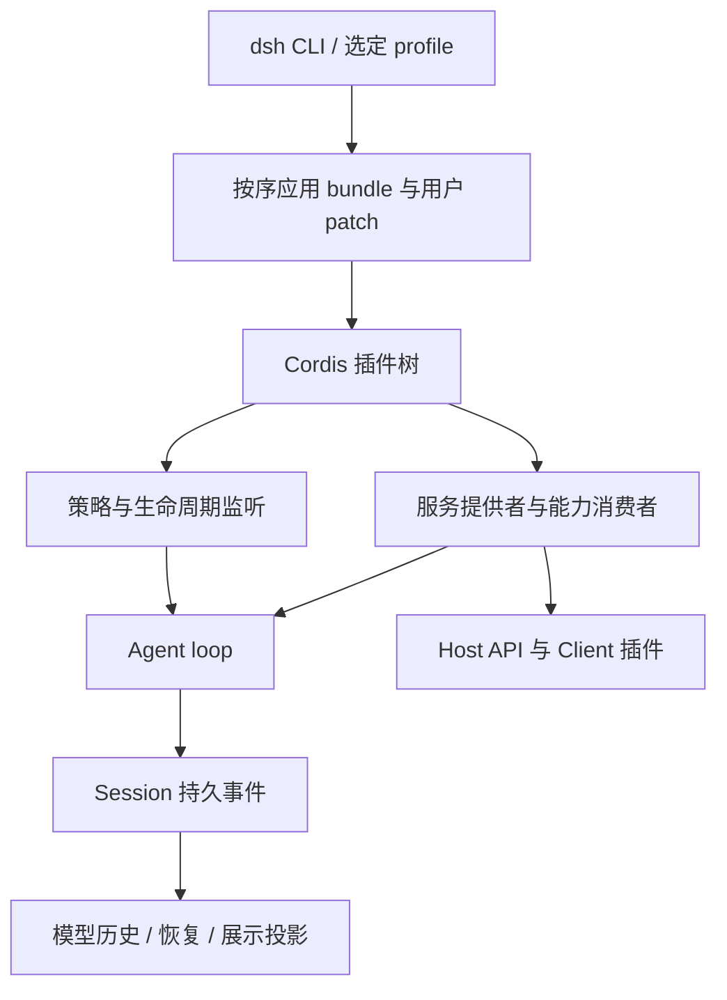

# Cordis 架构：为什么适合 Agent，以及它的边界

[返回概览](README.md) · [历史时间线](history.md)

## 先区分框架机制与产品设计

Cordis 提供 Context、服务依赖、类型化事件和可逆 effect。DSH 决定能力边界、Agent 循环、Session 事件语义、模型协议及产品组合。两者不是同一层：框架并没有替项目自动决定文件系统应拆几个包、任务如何完成、历史如何持久化。[S04](sources.md#s04)、[S07](sources.md#s07)

从公开材料可重建的设计链是：动态组合需要明确依赖；卸载需要回收贡献；Agent 的模型、工具、上下文和执行策略需要替换；因此产品能力通过服务/事件注册，配置描述实际组合。Cordis 的可逆 effect 与响应式依赖适合这种需要改变运行组合的产品。这是机制层面的推断 I；最早选型讨论正文不可得。2026-08-26 的[论文](https://arxiv.org/abs/2608.25512v1)是后来公开的形式化说明，不是 6 月选型会议记录。

## 四个重要接口习惯

| 机制 | DSH 如何使用 | 它解决什么，以及不解决什么 |
| --- | --- | --- |
| Service / inject | 提供者注册服务；消费者声明所需服务，由框架控制激活 | 服务没就绪时不强行访问；不能自动验证业务前置条件 |
| 类型化事件 | TypeScript declaration merging 扩展事件词汇；按串行、并行、waterfall 等模式组合 | 能力可插入观察/策略；监听者仍必须遵守 next、错误和取消语义 |
| 可逆 effect | 注册、监听等贡献拥有 disposer，卸载等待资源回收 | 支持生命周期复用与替换；不是事务数据库，也不能逆转任意外部 IO |
| 配置树 / Patch | 按明确次序挂载 bundle、用户覆盖和额外 overlay | 产品可组合、可替换；错误配置仍须在加载或最早可判定时明确失败 |

重点阅读当前 [turn flow](sources.md#s04) 和 [Agent 生命周期参考](sources.md#s47)。事件不全是持久记录：进行中的信号与已提交的 Session 事实承担不同职责。

## 能力 seam 的真正含义

DSH 的 seam 是完整能力：**Service Definition / Service Provider / Consumer**。Definition 声明 Cordis 服务与领域类型，Provider 接上本地、远程或受控实现，Consumer 负责模型/调用者使用的 API 或工具。shell 的“服务定义—本地/沙箱执行—bash 工具”是典型。[S07](sources.md#s07)

因此把工具 schema 和操作系统进程管理放在同一个包，会让替换执行后端牵动模型接口。拆开后可以更换 Provider 而保留工具形状；代价是更多 manifest、构建和注入接线。官方同时明确：只有一个合理实现/消费者、职责尚未独立演进时，不要预先拆包。

当前项目的 `packages/seam/` 主要放定义，DSH 用领域分组组织完整能力。名字相似不代表目录分类相同；本项目 L0–L12 是自己的约束，不能说成 DSH 官方的编号架构。

## 产品如何装起来

当前主要组合是 `dsh-base` 加 Web、Headless、SDK 或 ACP 的运行面 bundle，`sdk-minimal` 是明确例外：它拥有完整独立树，而不是默认叠加 base。覆盖次序为 profile 中的 bundles、profile patch、home patch、命令行 overlays；后层可以覆盖前层配置。支持的 Node 产品入口经 `dsh` profile 启动；真实组合测试必须走这个路径。[S04](sources.md#s04)

这不是“每个 Agent 身份一个插件”。服务提供可复用能力，Agent 与 preset 表达组合与实例。当前 Teamspace 的共享 Agent 数据目录也不应退回每创建一个 Agent 就加包和 patch 的形状。

## Session、上下文与恢复为什么是一条链

DSH 把模型历史从持久事件派生：新进入模型的输入必须有对应记录；工具结果、最终消息和结算过的失败尝试都能被恢复/回放读取。这样历史展示、恢复和模型输入不必各维护一套互相漂移的状态。[S48](sources.md#s48)

随后分清执行与上下文：补充上下文进入不唤醒执行的 next-step 队列，真实消息才提供唤醒工作；会话目标由独立 Goal 服务记录，round driver 通过 Agent、Session、Goal 服务驱动续轮。上下文压缩保留可追溯关系，但不意味着全文永远进入每个请求。[S08](sources.md#s08)、[S46](sources.md#s46)、[S49](sources.md#s49)

恢复也有边界：日志可重建持久事实，不自动重建每个进程对象。正在流式输出时的进程内增量帧与已结算的紧凑记录不同；在结算前硬崩溃，不能声称已保留完整输出。跨版本日志还需要显式 codec 和相邻迁移。[S04](sources.md#s04)、[S41](sources.md#s41)

## 三类事件，不要混成一个“工作记录”

- 持久 Session 事件：模型输入、工具结果、完成/失败结算、目标变化等需跨重启保存的事实。
- 活跃 Agent 事件：当前请求、准备输入、流式帧、状态变化等执行中的信号。
- 能力事件：工具/文件/模型能力的观察、拦截与策略扩展。

这对本项目的启示是：工作区顶部要读真实活跃状态，历史页读持久结算，聊天折叠记录关联持久工具摘要。等待、失败、取消和断线不是同一个状态；不能用固定绿色大块表达所有情况。

## 为什么 vendor Cordis，是否值得跟着做

官方早期理由是依赖 RC 阶段框架的 fiber、effect、waterfall 内部行为，需要固定源码并能够本地修补。当前 vendor manifest 记录上游提交和本地修改，涉及生命周期、加载、模块身份和 Node 内部接口等；同步与维护是明确成本。[S06](sources.md#s06)、[S05](sources.md#s05)

框架边界如下：上游提供通用机制；DSH vendor 是固定并有局部补丁的框架层；DSH packages 提供产品语义。不能把 npm 中同版本号的 Cordis 当作完全等同的 vendor 行为，也不能仅因 DSH vendor 就让本项目复制整个框架。

另一个需要保留的边界是动态扩展：进程内 vm 与受限 Context 有助于生命周期和误操作控制，暴露的文件系统/进程/网络服务仍有真实权限。它们不是可靠的恶意代码隔离边界。本项目现有沙箱与越界审批不能用 Cordis 热插拔替代。

## 源码阅读路线

按“当前配置—服务词汇—循环—日志—投影—扩展”读：`packages/bundle/base/cordis.patch.yml` → `docs/architecture.md` → `packages/core/agent-loop` → `packages/core/session` → `packages/session/session-projection` → 相关能力域。需要换实现时先找能力的 Definition、Provider 和 Consumer，别直接改核心 loop。

发布/格式问题另读 [S41](sources.md#s41)、[S42](sources.md#s42)；运行组合问题读 [S55](sources.md#s55)；Client 依赖边界读 [S54](sources.md#s54)。
