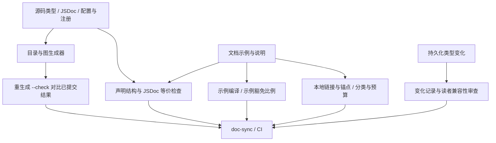

# CI、代码/文档一致性与审批

[返回概览](README.md) · [探针复现](verification.md)

## 一条执行链，而不是脚本名字清单

研究从工作流里的 `run`，追踪到 package script，再到 `scripts/run-gates.ts` 的实际叶子检查和实现。直接调用 `gatesForMode()` 得到当前基线的检查图：`ci-static` 62 项、`ci-coverage` 3 项、`ci-consumers` 10 项、`doc-sync` 43 项、`doc-quick` 21 项。它们存在交叉，不能相加当作独立检查数；coverage 的数量也随配置/平台变化。[S17](sources.md#s17)、[S18](sources.md#s18)、[gate-inventory.json](evidence/gate-inventory.json)

PR 工作流把 static、coverage、benchmarks、snapshots/artifact consumers、Node 兼容、Python 与 Windows 分成不同 job。最终 `all checks passed` 聚合依赖结果；`ci-master.yml` 另有串行参考路径，检查优化后的分组没有漏掉完整库存。GitLab 文件在本基线主要是 Python 标签发布，不是所有日常 PR 门禁的主入口。[S19](sources.md#s19)、[S20](sources.md#s20)、[S22](sources.md#s22)

## 检查矩阵

| 目标 | 实际命令/实现 | 执行入口 | 能证明的边界 |
| --- | --- | --- | --- |
| 类型 / lint / 重复代码 | `typecheck:contracts-ready`、`lint:contracts-ready`、`duplication`；Oxlint 与 jscpd | consumer build 后的 `lint-and-duplication`、Node 类型检查 | unused vars、规则和跨文件克隆；本次未找到统一圈复杂度阈值，不能说 DSH 和本项目一样用 25 |
| 包与依赖结构 | runtime closure、Cordis config、client domain graph 等脚本 | static / hygiene 叶子 | 导入、配置引用、Client 域边界；不证明业务抽象必要 |
| 单元覆盖 | Vitest + V8、分区合并、heavy suites 不插桩并行运行 | coverage lane | 纳入范围的每文件 100% 指标；有显式 UI、Typert、experimental 和平台豁免，不是全部源码 100% |
| 模型/协议/持久行为 | `test:snapshot`、`test:expected` | build 后 consumer | keyless 可重放场景与预期输出；改 golden 本身仍需审查 |
| 浏览器 | `DSH_SNAPSHOT=replay test:web:built` | consumer，其他 artifact readers 结束后 | Chromium/WebKit 的具体组装结果；几何/ARIA 通过仍不等于审美签字 |
| 文档示例 | `doc-typecheck:contracts-ready` | consumer build 后 | 可编译 API 使用；不验证文案含义和外部系统实际可用 |
| 声明与说明一致 | `verify-type-equiv` | doc-sync / static | 文档中的声明结构与原 JSDoc 对齐；不是只检查示例“能编译” |
| 生成文档新鲜度 | Cordis、tool、config、CLI、dependency、module graph 等 generator 的 `--check` | doc-sync / static | 源码重生成结果与已提交文档一致；模板内容质量仍需审查 |
| 文档完整性 | Markdown targets/anchors、budgets、subsystem pages、README summaries/limitations | doc-sync / doc-quick / static | 明确范围内的机械缺陷；网页远程链接不是都被这个 local-link gate 访问 |
| 历史与兼容 | persistence changes/releases/formats、archive seal | doc-sync / static；archive 使用 PR base SHA | 类型变化的记录和历史封印；实际 reader 是否安全仍需行为证据 |
| 审批 | `test:approval-policy`、trusted publisher | static 中策略测试 + 独立审批工作流 | 策略代码行为、精确 head 状态发布；实际分支必需检查配置此次未核实 |
| 真实模型 | `test:e2e`，独立 e2e workflow | 受信任 PR、主线、计划任务/手动触发 | 有 Key 时验证真实 provider；fork/无 Key 的跳过不是通过模型验收 |

检查来源：[S15](sources.md#s15)、[S18](sources.md#s18)、[S19](sources.md#s19)、[S21](sources.md#s21)、[S38](sources.md#s38)～[S40](sources.md#s40)、[S53](sources.md#s53)～[S56](sources.md#s56)。本次只运行下文列出的子集，不把静态追踪写成整套上游 CI 已跑过。

## 文档为什么能随代码更新

编译只能抓“示例不再能用”；`type-equiv` 还能抓“文档写了一个能编译但已过时的类型”。清单为文档、symbol 和源码建立一对一关系，比较结构与 JSDoc；公有类可比较去掉实现/private 成员后的公开声明。生成器则把穷举目录交回源码，拒绝手工维护的第二份 API 列表。[S25](sources.md#s25)、[S26](sources.md#s26)、[S31](sources.md#s31)～[S34](sources.md#s34)

文档例子允许标明草图豁免，但当可编译/ignore 样例合计至少 4 个且豁免超过 50% 时判红；已由类型等价/目录检查负责的代码块不进入这个比例。文档预算只覆盖 manifest 中 8 个 standing docs，以空白分隔 token 计数，并不是全站所有 Markdown 的统一 20KB 上限。中文项目不能机械复制英文 `wc -w`。[S26](sources.md#s26)、[S27](sources.md#s27)

双语 sidecar hash 检查结构配对有没有被遗忘；它不验证两种语言表达的是同一意义。持久化 schema diff/acknowledgement 要留下兼容与验证说明，也不证明已实现安全读者。DSH 在规则和审查中明示这些边界，避免把机械一致性当成语义等价。[S30](sources.md#s30)、[S42](sources.md#s42)、[S51](sources.md#s51)、[S52](sources.md#s52)

## 防止 Agent 把检查改弱：哪些已落实，哪些仍靠审查

历史档案使用封印 manifest，与可信 PR base 中的 manifest 对比。本次修改已归档正文会失败；同时修改正文与对应 hash、尝试重新封印，仍被原基线拦截。它保护的是封印历史，不是所有代码/测试不准修改。[S29](sources.md#s29)

审批 publisher 只执行受信任默认分支策略，把 PR Git 对象作为数据；先发布 pending，失败发布 error，避免依赖安装失败时沿用旧成功。普通 PR 检查执行 PR 代码，这是不同信任面。策略规定 2 分门槛，作者自 review 不计分，作者历史合并 credit 上限 1.1；默认有写权限 reviewer 1 分，特定 reviewer 2 分，并可按被修改旧生产行的 blame 调整权重。人类和 bot 都可能成为有效 reviewer。[S35](sources.md#s35)、[S36](sources.md#s36)、[S37](sources.md#s37)

因此不能写成“Agent 无法关闭任何门禁”或“规则修改一定经指定真人批准”。普通门禁实现、golden、覆盖排除和预算 manifest 都可在 PR 修改；可信审批发布能保证评分规则不被这个 PR 替换，但是否有合格审查、平台是否禁止合并、是否撤销旧批准仍需独立证据。审批 README 要求分支规则绑定 `weighted approval` status 及其预期来源；本次无管理员权限验证实际配置。

## 效率：有数据的变化与推断

[S45](sources.md#s45)记录一次 failover：static 排队 8分01秒、执行 1分41秒；它结束后 consumer 又排队 10分34秒、执行 1分58秒。原来的“复用一个 build”导致两个 runner 分配串行。方案把 Linux build 移给 consumer，static/coverage/consumer 各自申请 runner；静态检查与 artifact 消费只保留真实依赖。这是维护者的特定运行记录，不是本次重测，也不能推出普遍加速比例。

当前工作流取消被新推送替代的 PR run，PR 侧主要 restore 缓存，coverage 按耗时分区，benchmark 独占 runner 以避免同时负载扰乱时间预算。Web HMR 测试会改共享产物，因此它等 artifact readers 结束；“全并行”反而会产生不真实的失败。[S18](sources.md#s18)、[S19](sources.md#s19)

fail-fast 也是取舍：PR 关键 lane 设置失败即终止其余工作以控制 runner 成本；本地或其他模式可以继续收集结果。当前项目的逐项收集模式对排查有用，不应仅因 DSH 这样设置就全部改为 fail-fast。

## 这次实际验证了什么

| 实测 | 正向 | 故意改坏 | 恢复/边界 |
| --- | --- | --- | --- |
| standing-doc budget | 有效文档 exit 0 | 超预算 exit 1 | 使用临时 manifest；不代表完整预算政策认可 |
| Markdown link | 正确 heading exit 0 | 存在文件但不存在 anchor exit 1 | 外部链接不在此 local-link 判定范围 |
| type-equiv | 文档 string 与源 string 一致 exit 0 | 只把文档改为 number，exit 1 | 两个类型都可编译，说明比编译更强 |
| config source | apiKeyEnv 名称式配置 exit 0 | apiKey 的普通 `!!js` 环境内联 exit 1 | 脚本明示是普通单行形式扫描，不是完整 YAML 安全分析 |
| frozen archive | 基线 exit 0 | 正文篡改、正文+hash 篡改均 exit 1 | 原文/manifest 完全还原后 exit 0 |
| weighted policy | 80 tests 全通过 | 原测试含非法事件、权限/自 review 与 API 失败等场景 | 没有对真实 PR 发布 status |

完整命令、耗时、输出和复现说明见 [verification.md](verification.md)。没有运行模型 API、所有平台矩阵或生产数据迁移；本机小夹具耗时不作为官方 CI 性能基准。

## 仍不能由 CI 证明的事

“抽象值得存在”“说明准确易懂”“UI 好看”“Agent 回答满足需求”都需要语义或视觉审查。ACP 的手工挂载单元测试曾绕过真实加载入口，178 项通过与 100% 行覆盖仍挡不住启动故障。[S44](sources.md#s44)

本次公开 API 的最近样本主要是依赖更新 job，历史合并 #5946 的 PR API 返回 404，不能拿这些样本当全量 CI 已执行和保护分支已启用的证据。报告保留这些 U 项，而不把源码中存在的工作流直接记为平台治理完成。
