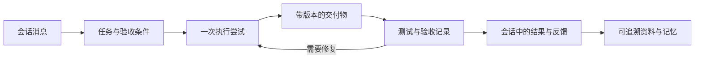

# 产品结构、视觉方向与验收

这是竞品研究后的长期建议，不是今天要完整实施的范围。用户随后明确要求当天可落地的小步；当前执行口径见[当日产品改进](../../product/README.md)。多人群聊、Agent 主动发言、透明执行记录和私有工作区隔离都保留；不更换 Cordis 或 UI 组件库。

## 先统一工作对象

核心使用场景假设：两位团队成员和不同职责的 Agent 协作完成一个小型研发交付。会话可以只用于讨论；不是每条消息都变成任务，也不是每个任务都需要人类审批。

| 对象 | 回答什么问题 | 至少需要的关系 |
| --- | --- | --- |
| 会话 | 人和 Agent 在讨论什么 | 成员、消息、决策、关联任务 |
| 任务 | 具体要交付什么、谁负责 | 来源消息、人类责任人或明确团队责任、执行 Agent、验收条件 |
| 执行尝试 | 这一次究竟做了什么 | 任务、Agent、开始结束时间、输入版本、模型及工具事件、失败原因 |
| 交付物 | 可以查看、运行或验证的结果是什么 | 任务、执行尝试、文件/文档、版本或指纹、访问范围 |
| 验收记录 | 哪个版本通过了什么检查 | 交付物版本、执行检查者、真实命令及输出、结论、反馈 |
| 资料与记忆 | 依据是什么、后续可复用什么 | 作用域、来源、版本、是否失效，以及与任务的关系 |

第一阶段可复用现有会话作为协作容器，先把上述关系补完整。只有跨会话、跨任务组织需求明确后，才考虑新增项目实体。不要因为竞品有 Workspace/Project 就一次建完所有层级。

建议的关系如下；它是产品对象图，不是数据库迁移方案。

## 状态必须分层

- 消息处理：待读取、后台已读取、有话想说、已答复。它只解释消息被怎样消费。
- 任务：待执行、执行中、受阻、待验收、已通过、失败、取消。已答复不代表任务已通过。
- 执行尝试：排队、运行、成功、失败、取消。重试产生新尝试，旧记录保留。
- 交付物：草稿、已交付、已验收、已失效。修改后的版本不能继承旧测试的通过结论。

不再把上述状态折叠为一个绿色“已完成”。排队给出原因与排位；受阻给出阻塞点与处理动作；只有明确要求人类判断的事项才展示可操作的决策入口。用户没有权限时说明谁能操作，不留下无人能解除的提示。

## 页面组织建议

主导航先保持四类：**会话、任务、资料、Agent**。模型与系统设置仍在已有独立后台，不把后台密钥管理混进 Team 成员页面。导航默认可读，折叠后保留名称提示与键盘入口。

| 页面 | 主内容 | 次内容 | 主要操作 |
| --- | --- | --- | --- |
| 会话 | 人与 Agent 的交流、实际交付和关键事件 | 成员、关联任务、重要资料 | 发言、@、把请求关联任务、查看交付 |
| 任务 | 目标、状态、交付版本、验收结果 | 执行尝试、来源消息、资料 | 委托、查看产物、运行检查、修复/重试 |
| 资料 | 目录、内容摘要、作用域 | 原文、来源、索引/记忆细节 | 搜索、预览、编辑、失效/删除 |
| Agent | 职责、可用能力、最近任务 | 模型、提示词与记忆设置 | 邀请、委托、配置、查看工作区 |
| 系统设置 | 服务配置及生效范围 | 模型选择、诊断、用量 | 保存、测试、切换、删除 |

这不表示现有入口立即删除。新增任务视图应首先复用当前队列、工作记录、来源关联和文件读取能力；知识库与记忆库在“资料”下仍须明确作用域，不能简单合并存储。

会话里的执行摘要继续用小型可展开组件：`Agent · 任务 · 状态 · 结果 · 详情`。按实际时间留在原位；点击查看该次执行，跳转可定位到对应任务/Agent/会话。详细追踪在侧面板或详情页，用户应能返回原来的消息与滚动位置。

## 风格应来自一致的产品规则

建议采用“清晰、紧凑、可信”的协作工具方向。保留现在的中性色表面和一个主强调色，明暗主题对应同一语义；不新增渐变、装饰卡片或聊天页营销标语。具体品牌名称和图形标识应在原型阶段统一，目前不凭空命名。

先落实以下五项，而不是逐页随手改颜色：

1. **排版层级：**页面标题、区块标题、正文、辅助文字只有四个稳定层级，中文正文可读；使用共享令牌，普通内容不靠放大卡片强调。
2. **页面密度：**1440×900 能看到当前工作及下一步。1100×720 不裁掉分页、结果或操作；列表内部滚动，不能用隐藏溢出伪造通过。
3. **操作层级：**一个主要操作；测试/预览为次级；删除与主要操作分隔。说明、状态反馈和工具栏各有位置，不再互相挤压。
4. **详情一致：**同类对象采用相同列表→预览→编辑路径，保留选择、筛选和滚动位置；设置与资源页面使用稳定布局模板。
5. **反馈一致：**正常、加载、排队、失败、空数据、长文本、多数据都先设计。错误有原因与可执行动作；一次操作只出现一处主要结果。

原型范围为四组：会话/任务联动、任务执行详情、资料浏览器、系统配置。每组覆盖上述状态；先桌面 1440×900 与 1100×720，不扩大成全部终端的重设计。精确间距和尺寸待原型测量确定，不从竞品文档网页推断应用令牌。

## 第一条必须跑通的产品流程

使用既有“优惠计算协作验收”场景，避免再用假数据宣称产品成熟。

1. 111 创建测试会话并邀请 123；两人分别登录，互相看到真实消息和成员变化。
2. 需求分析师整理约定，用户能从一条消息建立明确任务，看到验收条件与执行 Agent。
3. 编码者在真实执行环境写文件，交付带版本的产物。模型调用失败时任务受阻并提供准确原因。
4. 测试者通过受控交接读取同一交付版本，实际执行断言；故意改坏取整逻辑时测试必须失败。
5. 编码者修复后创建新版本；测试者重测，旧验收结果保留并显示已不适用于新版本。
6. 会话显示交付和验收摘要；刷新、离开再回来、服务重启后仍能定位全部结果。
7. 新会话邀请同一 Agent，按需求标识找回约定，核对其依据是实际长期记忆或可访问资料；不得将当前会话复述冒充跨会话记忆。

全部步骤完成前，不写“全链路已打通”。当前已证实邀请、部分需求答复与记忆写入；编码阶段的超时/fetch failed 和缺少产品化文件交接仍是阻塞，不因 Ping 通过而忽略。

## 分期与成本

| 优先级 | 工作 | 范围与相对成本 | 验收 |
| --- | --- | --- | --- |
| P0 | 对象、状态与页面结构说明 | 文档和原型，低；复用现有对象，不先迁移全部数据 | 同一任务能明确定位消息、尝试、产物与检查；没有语义冲突 |
| P0 | 稳定模型调用与真实编码交付 | 执行链路，成本取决于故障根因 | 实际 Agent 文件写入与自测成功，失败能准确归因和恢复 |
| P1 | 四组原型及统一设计令牌使用 | 设计与共享组件，中；不引入第二套 UI | 六类状态、两档桌面、主要交互可走通 |
| P1 | 任务与交付追踪、受控交接 | 产品流程，中至高；需设计访问与版本语义 | 测试者验证实际交付版本，修改后旧收据过期 |
| P1 | 两人多 Agent 端到端验收 | 自动化和真实试验，中 | 上述七步有可复核记录 |
| P2 | 扩展资料管理与非编码模板 | 在主流程验证后做，中 | 第二种工作无需另造一套页面与状态 |

成本是相对判断，不是承诺工期。先拿出对象/状态设计和四组原型，形成一个可审查的整体方案，再实施切片。

暂不做：全能 Agent 平台、拖拽工作流编辑器、更多空壳角色、全面 IDE、多个新层级、全量竞品功能复制。Cordis 架构和既有能力是可复用基础，不把内部架构层级直接当成用户导航。
